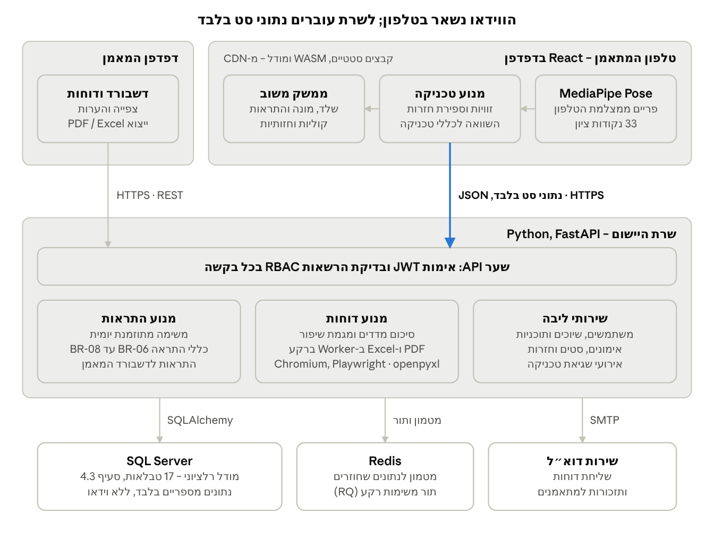
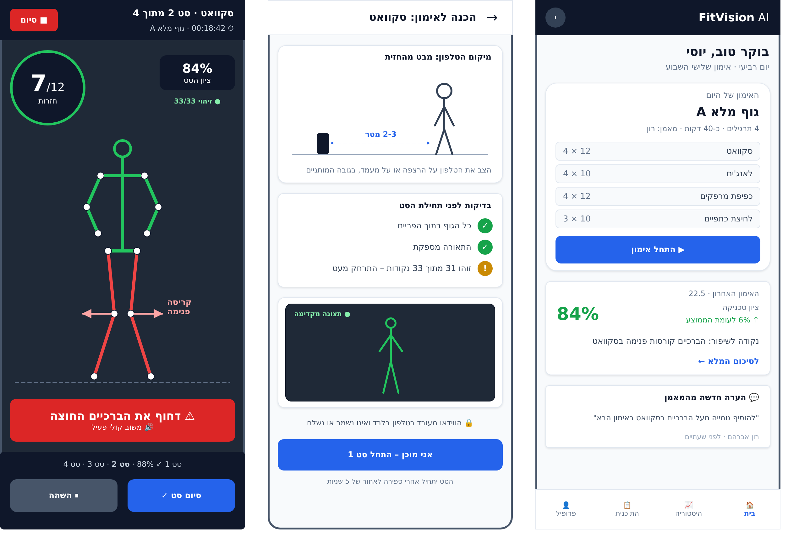

# FitVision AI

**מערכת מידע לניתוח טכניקת אימון באמצעות ראייה ממוחשבת והפקת דוחות מעקב למאמני כושר**

פרויקט גמר של 4 סטודנטים בחוג למערכות מידע, אוניברסיטת חיפה, בשנה"ל תשפ"ח (2027–2028).

FitVision AI מזהה את שלד המתאמן ממצלמת הטלפון ונותנת לו משוב טכניקה בזמן אמת. המערכת סופרת את החזרות, שומרת כל אימון ברמת הסט, החזרה ואירוע השגיאה, ומפיקה למאמן הכושר דוח מעקב אנליטי. ניתוח הווידאו רץ כולו בדפדפן, ולשרת עוברים נתונים מספריים בלבד: הווידאו לא נשלח לשרת ולא נשמר בו.

**▶ נסו בעצמכם:** https://fitvision-ai-naoj.onrender.com (השרת החינמי נרדם אחרי חוסר פעילות, ולכן הפתיחה הראשונה לוקחת כחצי דקה). כניסת הדגמה: מאמן `trainer@fitvision.app` / `Demo1234!`, מתאמן `trainee@fitvision.app` / `Demo1234!`.

## איך הפרויקט נבנה (שקיפות)

את המימוש בניתי בעזרת **Claude Code** של Anthropic, שעבד כשותף לתכנות. הקומיטים שנכתבו בעזרתו מסומנים בשורת `Co-Authored-By: Claude`, או שהוא מופיע בהם כמחבר. כך אפשר לראות בהיסטוריה בדיוק מה נעשה ואיך.

**מה עשיתי אני:**
- הגדרתי את המוצר ואת הדרישות, וכתבתי את מסמך האפיון: ‏20 User Stories, ‏ERD, ‏DFD, כללים עסקיים ותוכנית בדיקות.
- קבעתי את הארכיטקטורה ואת בחירות הטכנולוגיה.
- בדקתי את המערכת בטלפון אמיתי, ובעקבות הבדיקה כיילתי את המנוע: סינון רעשים בספירת החזרות וספים חדשים לכפיפת מרפקים (מיגרציה `0002`). הממצאים מתועדים בפרק 10.4.
- פרסתי את המערכת לענן (Render ו-Neon PostgreSQL) והגדרתי CI שבודק אותה על שלושה מסדי נתונים.

**מה כדאי לבדוק בקוד:**
- [`client/src/engine/engine.ts`](client/src/engine/engine.ts): מכונת המצבים שסופרת חזרות מזוויות המפרקים, כולל היסטרזיס וסינון רעשים.
- [`client/src/offline/sync.ts`](client/src/offline/sync.ts): תור לא מקוון ב-IndexedDB, שמסתנכרן לשרת בלי לאבד נתונים.
- [`server/app/routers/`](server/app/routers/) ו-[`server/tests/test_rbac.py`](server/tests/test_rbac.py): הרשאות לפי תפקיד, והבדיקות שלהן.
- [`.github/workflows/ci.yml`](.github/workflows/ci.yml): ‏38 בדיקות שרת ו-28 בדיקות לקוח ו-E2E, על SQLite, ‏PostgreSQL ו-SQL Server.

## מסמך האפיון

| קובץ | תיאור |
| --- | --- |
| [`docs/FitVision-AI-מסמך-אפיון.docx`](docs/) | המסמך המלא בקובץ Word אחד, מימין לשמאל |
| [`docs/FitVision-AI-מסמך-אפיון.pdf`](docs/) | אותו מסמך כקובץ PDF |
| `docs/*.md` | המקור לכל פרק, בקובצי Markdown |

**תוכן המסמך**

0. [תקציר ומבנה המסמך](docs/00-תקציר-ומבנה-המסמך.md)
1. [מבוא](docs/01-מבוא.md)
2. [סקירת מצב קיים ופתרונות קיימים](docs/02-סקירת-מצב-קיים.md)
3. [ניתוח דרישות](docs/03-ניתוח-דרישות.md): 20 User Stories ו-14 דרישות לא פונקציונליות
4. [ניתוח ותכן המערכת](docs/04-ניתוח-ותכן.md): ארכיטקטורה, DFD, ERD, כללים עסקיים, RBAC ואלגוריתם
5. [אפיון ממשק המשתמש](docs/05-ממשק-משתמש.md)
6. [סביבת פיתוח וטכנולוגיות](docs/06-טכנולוגיות.md)
7. [תוכנית עבודה וניהול הפרויקט](docs/07-תוכנית-עבודה.md): Scrum, ‏10 ספרינטים ו-113 SP
8. [ניהול סיכונים](docs/08-ניהול-סיכונים.md): ‏R-01 עד R-08
9. [תוכנית בדיקות והערכה](docs/09-תוכנית-בדיקות.md): ‏TC-01 עד TC-10, דיוק מול 40 סרטונים ו-SUS
10. [סטטוס בסוף סמסטר א' ותוכנית לסמסטר ב'](docs/10-סטטוס-ותוכנית-המשך.md)
- [ביבליוגרפיה](docs/11-ביבליוגרפיה.md) ו[נספחים](docs/12-נספחים.md): ‏API, ‏SUS, ‏PoC וקבצי תכן

## ארכיטקטורה



| שכבה | טכנולוגיה |
| --- | --- |
| לקוח | React 19, TypeScript, Vite, PWA, TanStack Query, Recharts; שמירה ב-IndexedDB בניתוק רשת |
| מנוע ראייה | MediaPipe Pose Landmarker‏ (`@mediapipe/tasks-vision`) ב-Web Worker, במצב VIDEO; שלד על Canvas; world landmarks לעומק |
| שרת | Python 3.12, FastAPI, Pydantic v2, SQLAlchemy 2.0, Alembic, Uvicorn, Argon2, JWT, APScheduler |
| מסד נתונים | SQL Server 2022 Express ב-Docker, עם 17 טבלאות מנורמלות |
| דוחות | Jinja2 עם `dir="rtl"`; ‏PDF דרך Chromium ו-Playwright; ‏Excel דרך openpyxl |
| מטמון ותור משימות | Redis 7 ותור RQ עם Worker נפרד; קבצים סטטיים דרך CDN |
| בדיקות ו-CI | pytest, ‏Vitest ו-React Testing Library, ‏Postman, ‏GitHub Actions, ‏Lighthouse CI, ‏ESLint, ‏Prettier, ‏Ruff |

**ביצועים:** שלד מסך בזמן טעינה, עדכון אופטימי, פיצול קוד, רשימות וירטואליות, ‏CDN ודחיסה, אינדקסים ומטמון, ותקציב ביצועים שנבדק ב-CI ואצל משתמשים אמיתיים. הפירוט בסעיף 6.3.

**תרגילי ה-MVP:** סקוואט ולחיצת כתפיים מצולמים מהחזית; לאנג'ים וכפיפת מרפקים מצולמים מהצד.

**שחקנים:** מתאמן (בטלפון), מאמן כושר ומנהל מערכת (במחשב), עם הרשאות מבוססות-תפקידים (RBAC).

## תרשימים

| קובץ draw.io | תכולה |
| --- | --- |
| [`FitVision_UseCase.drawio`](diagrams/drawio/FitVision_UseCase.drawio) | 3 שחקנים ו-20 מקרי שימוש |
| [`FitVision_DFD.drawio`](diagrams/drawio/FitVision_DFD.drawio) | רמה 0; רמה 1 עם 7 תהליכים, 6 מאגרים ו-24 זרימות (F1 עד F24) |
| [`FitVision_ERD.drawio`](diagrams/drawio/FitVision_ERD.drawio) | 17 טבלאות, כולל `consent_at` ו-`invite_code` |
| [`FitVision_Wireframes.drawio`](diagrams/drawio/FitVision_Wireframes.drawio) | 5 מסכים: 3 בטלפון ו-2 במחשב |

האיורים שבמסמך נמצאים ב-`diagrams/figures/`, ותמונות המסכים ב-`diagrams/wireframes/`.



## מבנה המאגר

| תיקייה | תוכן |
| --- | --- |
| `server/` | שרת ה-API: מודלים, כללים עסקיים, דוחות, משימות רקע ובדיקות pytest |
| `client/` | אפליקציית הטלפון (PWA): מנוע הטכניקה, אימון חי, מסכי מאמן ומנהל, בדיקות vitest ו-Playwright |
| `docs/` | מסמך האפיון: Markdown, ‏Word ו-PDF, ומדריך ההרצה והניסוי |
| `diagrams/drawio/` | ארבעת קובצי ה-draw.io לעריכה |
| `diagrams/figures/` | האיורים שבמסמך (PNG) |
| `diagrams/wireframes/` | תמונות 5 מסכי הממשק |
| `poc/` | הוכחת ההיתכנות (T-03): MediaPipe ב-Web Worker וספירת חזרות בסקוואט |
| `tools/` | סקריפטים שמייצרים את התרשימים, את תמונות המסכים ואת קובצי ה-Word וה-PDF |

## האפליקציה

הקוד המלא של ה-MVP נמצא ב-`server/` (FastAPI, ‏SQL Server, ‏Redis ו-RQ) וב-`client/` (React PWA, ‏MediaPipe ב-Web Worker). הרצה ב-Docker:

```bash
cp .env.example .env
docker compose up -d --build     # http://localhost:8080
```

הוראות מלאות: הרצה בלי Docker, גישה מהטלפון ב-HTTPS, בדיקת מכשיר ותסריט ניסוי אמת, נמצאות ב-[docs/מדריך-הרצה-וניסוי-בטלפון.md](docs/מדריך-הרצה-וניסוי-בטלפון.md). הבדיקות האוטומטיות רצות ב-GitHub Actions, והתוצאות נשמרות בענף `ci-reports`.

**קישור קבוע לאפליקציה:** https://fitvision-ai-naoj.onrender.com (Render, מסד נתונים PostgreSQL ב-Neon, בחינם). אפשר להתקין אותה כאפליקציה מכל טלפון, טאבלט או מחשב נייד עם מצלמה.

### יכולות עיקריות

- **זיהוי תנוחה בזמן אמת בטלפון** (MediaPipe ב-Web Worker, עם GPU ומעבר אוטומטי למודל Lite): הווידאו לא יוצא מהמכשיר.
- **4 תרגילים**, ספירת חזרות במכונת מצבים, וכללי טכניקה שנשמרים כנתונים ומכוילים מניסוי אמת (מיגרציה 0002).
- **מאמן וירטואלי:**
  - הערה אחת לכל חזרה, בניסוחים מתחלפים.
  - הנחיות להשלמת התנועה, עידוד ואבני דרך.
  - צלילים, והקראה קולית לבחירה.
- **חוויית אימון:**
  - טבעת התקדמות סביב המונה.
  - הבזק ירוק או כתום אחרי כל חזרה.
  - קונפטי בסיום סט.
  - רצף ימים ושיא אישי במסך הבית.
- **עבודה בלי רשת:** האימון נשמר בטלפון ומסונכרן אוטומטית.
- **דוחות אוטומטיים:**
  - נקודות כשל ומגמה מול 3 האימונים הקודמים.
  - הערות מאמן וייצוא ל-PDF מימין לשמאל, ל-Excel ול-JSON.
- **דשבורד מאמן:** התראות, תוכניות אימון, גרפי מגמה ותזכורות.
- **ניהול:** משתמשים, עריכת כללים ויומן ביקורת.
- **אפליקציה שמתקינים:** PWA לטלפון, לטאבלט ולמחשב נייד, כולל iPhone ו-iPad.
- **בדיקות:** pytest על SQLite ועל SQL Server אמיתי, vitest, ו-Playwright במסך טלפון עם MediaPipe אמיתי. בנוסף נבדקות המערכת המלאה ב-Docker והקונטיינר היחיד.

מדריך למשתמש: [docs/מדריך-למשתמש.md](docs/מדריך-למשתמש.md). ב-Windows אפשר להריץ בלחיצה כפולה על `start-fitvision-light.bat`.

## הוראות הרצה

**הוכחת ההיתכנות (PoC)**

```bash
cd poc
npm install
npm test        # 8 בדיקות יחידה
npm run dev     # בטלפון יש לגשת בכתובת HTTPS כדי שהמצלמה תופעל
```

**יצירה מחדש של התוצרים**

```bash
python3 tools/generate_drawio.py                                   # ארבעת קובצי ה-draw.io (נוצרים בתיקייה הנוכחית)
python3 tools/render_wireframes.py diagrams/drawio/FitVision_Wireframes.drawio out/   # תמונות המסכים (Playwright)
python3 tools/build_docx.py                                        # docs/FitVision-AI-מסמך-אפיון.docx (pandoc)
python3 tools/docx_to_pdf.py docs/FitVision-AI-מסמך-אפיון.docx docs/FitVision-AI-מסמך-אפיון.pdf   # LibreOffice
```

את קובצי ה-`.drawio` פותחים ב-[app.diagrams.net](https://app.diagrams.net) או בתוסף draw.io ל-VS Code.

## צוות

| # | תפקיד | Story Points |
| --- | --- | --- |
| 1 | מפתח Full-Stack מוביל, ארכיטקטורה ו-SQL Server | 33 |
| 2 | Frontend, ‏UI/UX, ‏PWA וייצוא דוחות | 34 |
| 3 | אלגוריתמים, MediaPipe ב-Web Worker וכיול כללים | 34 |
| 4 | מנהל איכות, בדיקות ו-PMO (Scrum Master) | 12, ועוד ניהול ובדיקות |
