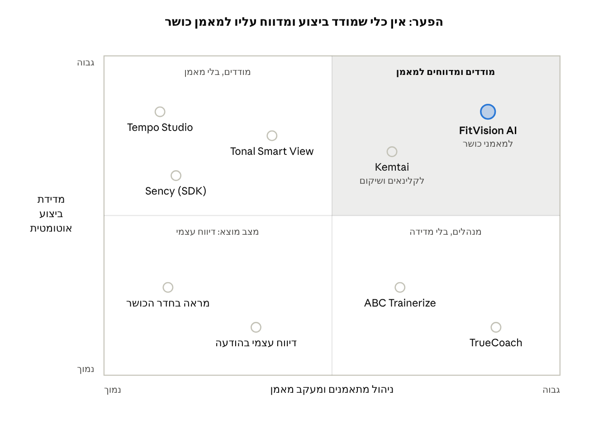

# פרק 2 – סקירת מצב קיים ופתרונות קיימים

## 2.1 סקירת כלים קיימים בשוק

הכלים הקיימים מתחלקים לשתי קבוצות נפרדות: מערכות שמודדות תנועה ונותנות משוב למתאמן, ופלטפורמות שמנהלות את הקשר בין מאמן ללקוחותיו. אף כלי בסקירה אינו משלב את שתיהן עבור מאמן כושר אישי, על גבי מצלמת טלפון בלבד.

**קבוצה א' – מערכות משוב תנועה.** מערכות אלו מזהות את תנוחת הגוף ונותנות תיקונים בזמן אמת, אך רובן דורשות חומרה ייעודית או פונות לשוק אחר.

- [Tempo Studio](https://www.garagegymreviews.com/tempo-studio-review) הוא חדר כושר ביתי חכם במחיר של כ-2,495 דולר, בתוספת מנוי חודשי. הוא משתמש בחיישני עומק תלת-ממדיים, סופר חזרות ונותן הנחיות טכניקה בסיסיות.
- [Tonal Smart View](https://tonal.com/blogs/all/tonal-smart-view) מוסיף ניתוח מצלמה ממצלמת הטלפון למכשיר הכוח של Tonal, ומציג בסיכום האימון אילו חזרות דרשו תיקון. התכונה זמינה רק לבעלי המכשיר.
- [Kemtai](https://kemtai.com) היא פלטפורמת ווב לניתוח תנועה במצלמה, ללא חיישנים, עם משוב קולי וחזותי בזמן אמת. היא כוללת לוח בקרה עם דיווח עד רמת החזרה, אך פונה בעיקר למערכות בריאות ושיקום ולא למאמני כושר.
- [Sency](https://athletechnews.com/sency-transforms-fitness-market-ai-motion-tracking/) מוכרת ערכת פיתוח (SDK) לעסקי כושר, הכוללת ספירת חזרות, מדידת יציבה ומשוב בזמן אמת. זהו רכיב טכנולוגי להטמעה, ולא מערכת מעקב מוכנה למאמן.

**קבוצה ב' – פלטפורמות ניהול למאמנים.** מערכות אלו מנהלות תוכניות אימון, לקוחות ותקשורת, אך אינן מודדות את הביצוע עצמו.

- [ABC Trainerize](https://www.capterra.com/p/140262/Trainerize/) מאפשרת בניית תוכניות אימון ותזונה, מעקב התקדמות, הודעות וחיבור לשעונים חכמים. לא נמצא בה ניתוח טכניקה ממצלמה.
- [TrueCoach](https://truecoach.co/blog/managing-multiple-offer-types-in-one-platform-why-coaches-choose-truecoach) מאפשרת לבנות ולתזמן אימונים, ולמתאמן להעלות סרטון לבדיקת טכניקה. הסרטון נבדק ידנית על ידי המאמן, ללא ניתוח אוטומטי.

**טבלה 2.1 – השוואת יכולות**

| כלי | קבוצה | אמצעי מדידה | משוב טכניקה בזמן אמת | ניהול מתאמנים למאמן | דוח ביצוע אוטומטי למאמן | חומרה נדרשת |
| --- | --- | --- | --- | --- | --- | --- |
| Tempo Studio | משוב תנועה | חיישני עומק 3D | כן, בסיסי | לא | לא | מכשיר ייעודי |
| Tonal Smart View | משוב תנועה | חיישני כבלים + מצלמת טלפון | כן | לא | לא | מכשיר ייעודי |
| Kemtai | משוב תנועה | מצלמה | כן | כן, למטפלים | כן, לקלינאים | מצלמה בלבד |
| Sency | רכיב SDK | מצלמה | כן | לא – תלוי במוצר המטמיע | לא – תלוי במוצר המטמיע | מצלמה בלבד |
| ABC Trainerize | ניהול מאמנים | ללא, דיווח ידני ושעונים | לא | כן | חלקי, נתוני דיווח ושעונים | ללא |
| TrueCoach | ניהול מאמנים | ללא, סרטון לבדיקה ידנית | לא | כן | לא | ללא |
| **FitVision AI** | **משולב** | **מצלמת טלפון** | **כן** | **כן** | **כן, ברמת סט, חזרה ושגיאה** | **מצלמה בלבד** |

המידע בטבלה מבוסס על המקורות המקושרים כפי שנבדקו באוקטובר 2026, ועשוי להשתנות.

## 2.2 טכנולוגיות הערכת תנוחה

הפרויקט יתבסס על MediaPipe Pose (מודל BlazePose), משום שהוא היחיד מבין החלופות שמשלב 33 נקודות ציון, ריצה בזמן אמת בטלפון ותמיכה בדפדפן. הערכת תנוחה (Pose Estimation) היא משימה בראייה ממוחשבת שבה מזוהים מיקומי מפרקי הגוף בכל פריים של וידאו. מתוך מיקומי המפרקים ניתן לחשב זוויות, ומהזוויות – לספור חזרות ולזהות שגיאות טכניקה.

**טבלה 2.2 – השוואת ספריות הערכת תנוחה**

| ספרייה | נקודות ציון | ריצה בדפדפן או בטלפון | מספר אנשים בפריים | התאמה לפרויקט |
| --- | --- | --- | --- | --- |
| [MediaPipe BlazePose](https://www.research.google/blog/on-device-real-time-body-pose-tracking-with-mediapipe-blazepose/) (Google) | 33 | כן, בזמן אמת על מעבד הטלפון | אחד | גבוהה – כולל כפות רגליים וידיים, ומיועד במפורש לכושר |
| [MoveNet](https://blog.tensorflow.org/2021/05/next-generation-pose-detection-with-movenet-and-tensorflowjs.html) (TensorFlow.js) | 17 | כן, 30+ פריימים לשנייה ברוב המכשירים | אחד | בינונית – מהיר, אך ללא נקודות בכפות הרגליים |
| [YOLO Pose](https://docs.ultralytics.com/tasks/pose) (Ultralytics) | 17 | בעיקר בצד שרת ב-Python | כמה | נמוכה – דורש שליחת וידאו לשרת |
| OpenPose (אוניברסיטת קרנגי מלון) | גוף, ידיים ופנים | לא, דורש מחשב חזק | כמה | נמוכה – כבד מדי לטלפון |

שלושה שיקולים הכריעו את הבחירה:

1. **פרטיות.** ריצה על מכשיר המשתמש מאפשרת לא להעביר וידאו לשרת כלל, בהתאם לדרישת הפרטיות שהוגדרה בפרק 1.3.
2. **כיסוי מפרקים.** 33 נקודות הציון כוללות עקבים ואצבעות רגליים, הנדרשים לבדיקת יציבות בסקוואט ובלאנג'ים. במודלים של 17 נקודות הן חסרות.
3. **התאמה לתחום.** מפתחי BlazePose הציגו ספירת חזרות ובדיקת טכניקה כיישום יעד של המודל.

## 2.3 הפער שהפרויקט ממלא

הפער אינו טכנולוגיית המדידה עצמה, שכבר קיימת, אלא שכבת מערכת המידע שמעבירה את נתוני המדידה למאמן הכושר. איור 2.1 ממקם את הכלים מסעיף 2.1 לפי שני ממדים: עד כמה הם מודדים ביצוע באופן אוטומטי, ועד כמה הם תומכים בניהול מתאמנים על ידי מאמן.

*איור 2.1 – מיקום הכלים הקיימים לפי מדידת ביצוע ומעקב מאמן*

כלי המדידה שומרים את הנתונים אצל המתאמן, ופלטפורמות המאמנים נשענות על דיווח עצמי ועל סרטונים שנבדקים בעין. Kemtai קרובה לרביע היעד, אך בנויה סביב תהליכי עבודה של קלינאים ומערכות בריאות, ולא סביב מאמן כושר עצמאי.

FitVision AI ממלאת את הפער באמצעות חמישה רכיבי מערכת מידע, שאף אחד מהם אינו קיים במלואו בכלים שנסקרו עבור מאמני כושר:

1. **ניהול משתמשים והרשאות (RBAC) עם שיוך מאמן-מתאמן** – המאמן רואה רק מתאמנים שאישרו את השיוך אליו.
2. **תיעוד מובנה ברמת הסט, החזרה ואירוע השגיאה** – נתוני המצלמה נשמרים במסד נתונים רלציוני וניתנים לתחקור.
3. **מנוע דוחות למאמן** – דוח סיכום אוטומטי לכל אימון, עם מגמת שיפור, הערות מאמן וייצוא ל-PDF או ל-Excel.
4. **כללי טכניקה כנתונים** – ספי הזוויות של כל תרגיל נשמרים בטבלה שמנהל המערכת עורך, כך שתרגיל חדש אינו דורש פיתוח.
5. **התראות חכמות בדשבורד המאמן** – כללים עסקיים מסמנים מתאמנים עם שגיאה חוזרת, ירידה בציון או חוסר פעילות.

רכיבים אלו מפורטים בפרק 3 (דרישות) ובפרק 4 (תכן המערכת).

**מקורות לפרק**

- [Tempo Studio Review](https://www.garagegymreviews.com/tempo-studio-review) – Garage Gym Reviews
- [Tonal Smart View](https://tonal.com/blogs/all/tonal-smart-view) – Tonal, 2022
- [Kemtai – Motion Tracking Exercise Platform](https://kemtai.com)
- [Sency Transforms Fitness Market with AI Motion Tracking](https://athletechnews.com/sency-transforms-fitness-market-ai-motion-tracking/) – Athletech News, 2024 (תוכן ממומן)
- [ABC Trainerize](https://www.capterra.com/p/140262/Trainerize/) – Capterra
- [TrueCoach](https://truecoach.co/blog/managing-multiple-offer-types-in-one-platform-why-coaches-choose-truecoach) – TrueCoach
- [On-device, Real-time Body Pose Tracking with MediaPipe BlazePose](https://www.research.google/blog/on-device-real-time-body-pose-tracking-with-mediapipe-blazepose/) – Google Research, 2020
- [Next-Generation Pose Detection with MoveNet and TensorFlow.js](https://blog.tensorflow.org/2021/05/next-generation-pose-detection-with-movenet-and-tensorflowjs.html) – TensorFlow Blog, 2021
- [Pose Estimation](https://docs.ultralytics.com/tasks/pose) – Ultralytics Docs
