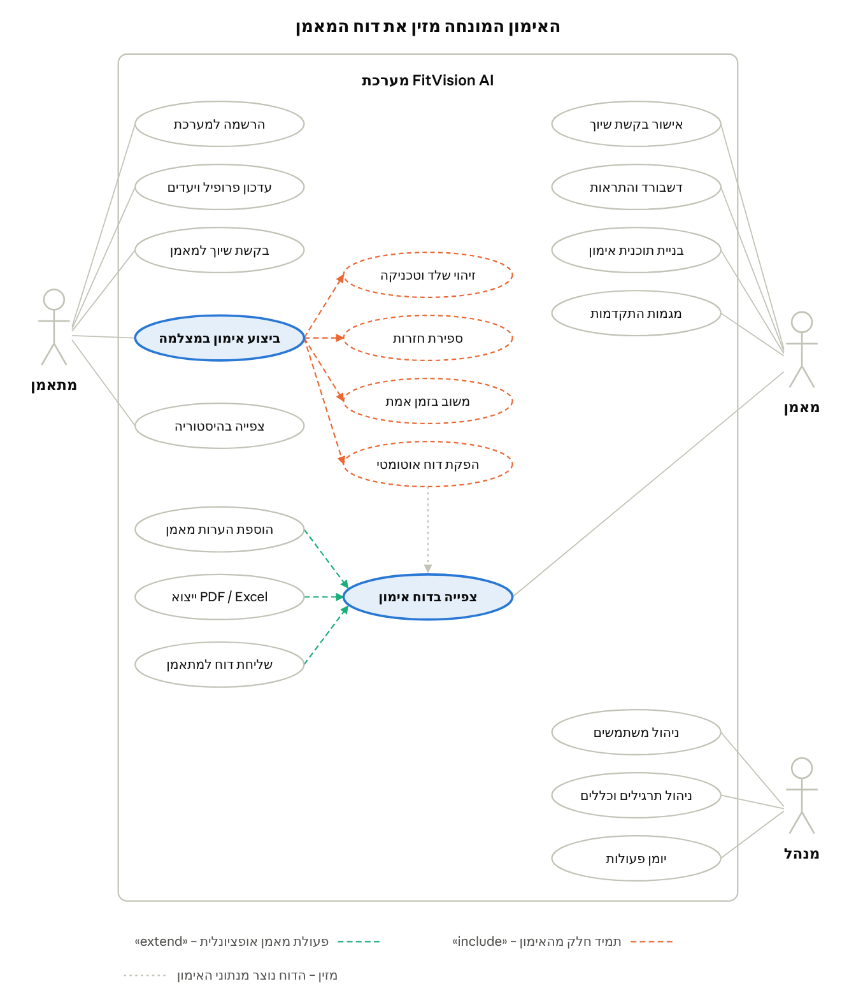

# פרק 3 – ניתוח דרישות

## 3.1 בעלי עניין ושחקנים

למערכת שלושה שחקנים ישירים – מתאמן, מאמן ומנהל מערכת – ושני בעלי עניין עקיפים. כל שחקן מקבל הרשאות לפי תפקידו (RBAC), והרשאות המאמן מוגבלות למתאמנים ששיוכם אליו אושר.

**טבלה 3.1 – שחקנים ובעלי עניין**

| בעל עניין | סוג | צורך מרכזי | הרשאות במערכת |
| --- | --- | --- | --- |
| מתאמן (Trainee) | שחקן ישיר | לבצע תרגילים בטכניקה נכונה ולקבל משוב מיידי | ניהול הפרופיל שלו, ביצוע אימונים, צפייה בהיסטוריה ובסיכומים שלו בלבד |
| מאמן כושר (Trainer) | שחקן ישיר | לעקוב אחר ביצועי המתאמנים מרחוק על בסיס נתונים | ניהול תוכניות, צפייה בנתוני מתאמנים משויכים בלבד, הערות, ייצוא ושליחת דוחות |
| מנהל מערכת (Admin) | שחקן ישיר | לשמור על תקינות המערכת ועל מאגר התרגילים | ניהול משתמשים ותפקידים, ניהול תרגילים וכללי טכניקה, צפייה ביומן הפעולות |
| ארגון לקוח (חדר כושר או סטודיו) | בעל עניין עקיף | כלי שמשפר את שירות המאמנים ואת שימור המנויים | ללא גישה ישירה; משתתף באפיון ובבדיקות הקבלה |
| צוות הפרויקט והמנחה האקדמי | בעל עניין עקיף | מערכת שעומדת בדרישות הקורס ובמדדי ההצלחה | גישת פיתוח ובדיקות בלבד |

## 3.2 דרישות פונקציונליות (User Stories)

הדרישות הפונקציונליות מנוסחות כ-20 User Stories, מהן 13 בעדיפות Must שמרכיבות את ה-MVP. כל סיפור בנוי בתבנית "כ-\[תפקיד\], אני רוצה \[פעולה\], כדי \[תועלת\]", וקריטריוני הקבלה שלו ישמשו כבסיס לתסריטי הבדיקה בפרק 9. העדיפות נקבעת לפי שיטת MoSCoW: Must – חובה ל-MVP, Should – חשובה אך ניתנת לדחייה לסמסטר ב', Could – תוספת אם יוותר זמן.

**טבלה 3.2 – User Stories**

| מזהה | שחקן | User Story | עדיפות | קריטריוני קבלה |
| --- | --- | --- | --- | --- |
| US-01 | מתאמן | כמתאמן, אני רוצה להירשם עם דוא"ל וסיסמה, כדי לקבל גישה למערכת | Must | דוא"ל ייחודי במערכת; סיסמה של 8 תווים לפחות; לאחר ההרשמה מוצג אשף השלמת פרופיל |
| US-02 | מתאמן | כמתאמן, אני רוצה לעדכן גובה, משקל, רמת כושר ופציעות עבר, כדי שהמאמן יתאים לי תוכנית | Must | ערכים מספריים נבדקים מול טווח סביר; הפרופיל גלוי רק למאמן המשויך |
| US-03 | מתאמן | כמתאמן, אני רוצה לשלוח בקשת שיוך למאמן לפי קוד הזמנה, כדי שיוכל לעקוב אחרי | Must | הבקשה נשמרת בסטטוס Pending; המאמן מקבל התראה; למתאמן מאמן פעיל אחד לכל היותר |
| US-04 | מתאמן | כמתאמן, אני רוצה לבחור אימון מהתוכנית ולהפעיל את מצלמת הטלפון, כדי להתאמן עם ניתוח תנועה | Must | בקשת הרשאת מצלמה והסכמה מדעת בשימוש הראשון; הנחיית מיקום הטלפון לכל תרגיל; האימון מתחיל רק כשכל הגוף מזוהה בפריים |
| US-05 | מתאמן | כמתאמן, אני רוצה שהמערכת תספור את החזרות שלי, כדי להתרכז בתרגיל ולא בספירה | Must | דיוק של 95% לפחות מול ספירה ידנית; המונה מתעדכן תוך 300 מילישניות; חזרה בטווח חלקי נספרת אך מסומנת כלא תקינה |
| US-06 | מתאמן | כמתאמן, אני רוצה לקבל משוב מיידי כשהטכניקה שלי שגויה, כדי לתקן אותה בחזרה הבאה | Must | הודעת תיקון וסימון המפרק באדום תוך 300 מילישניות; משוב קולי שניתן להשתיק; התראה אחת לכל היותר לכל חזרה |
| US-07 | מתאמן | כמתאמן, אני רוצה לראות סיכום קצר בסיום האימון, כדי לדעת מה לשפר | Should | מוצגים סך חזרות, ציון טכניקה ושתי השגיאות השכיחות |
| US-08 | מתאמן | כמתאמן, אני רוצה לצפות בהיסטוריית האימונים שלי, כדי לראות את ההתקדמות | Should | רשימת אימונים מהחדש לישן עם סינון לפי תרגיל; גרף ציון טכניקה לאורך זמן |
| US-09 | מאמן | כמאמן, אני רוצה לאשר או לדחות בקשות שיוך, כדי לשלוט במי משויך אלי | Must | אישור מעביר לסטטוס Active ופותח גישה לנתוני המתאמן; דחייה מודיעה למתאמן; סיום שיוך סוגר את הגישה מיד |
| US-10 | מאמן | כמאמן, אני רוצה דשבורד של כל המתאמנים שלי, כדי לדעת למי לפנות קודם | Must | לכל מתאמן: אימון אחרון, ציון ממוצע ומגמה; מיון וסינון לפי כל עמודה; טעינה תוך 2 שניות עבור 50 מתאמנים |
| US-11 | מאמן | כמאמן, אני רוצה לבנות תוכנית אימון למתאמן, כדי שידע מה לבצע | Must | בחירת תרגילים מהמאגר עם סטים, חזרות ומנוחה; התוכנית מוצגת למתאמן מיד לאחר השמירה |
| US-12 | מאמן | כמאמן, אני רוצה לקבל דוח סיכום אוטומטי לכל אימון, כדי לדעת מה קרה בפועל | Must | הדוח זמין תוך 10 שניות מסיום האימון; כולל חזרות, ציון, שגיאות לפי סט ומגמת שיפור; גלוי רק למאמן המשויך |
| US-13 | מאמן | כמאמן, אני רוצה להוסיף הערות לדוח, כדי לתת למתאמן הנחיות מקצועיות | Should | הערה נשמרת עם תאריך ושם המאמן; סטטוס הדוח משתנה ל-Reviewed |
| US-14 | מאמן | כמאמן, אני רוצה לייצא דוח כקובץ PDF או Excel, כדי לשמור אותו ולשתף אותו | Must | הקובץ נוצר תוך 5 שניות; התוכן תואם למסך הדוח כולל הערות מאמן; תמיכה מלאה בעברית; הייצוא נרשם |
| US-15 | מאמן | כמאמן, אני רוצה לשלוח את הדוח למתאמן, כדי שיקבל סיכום רשמי | Should | שליחה בדוא"ל או בתוך המערכת; סטטוס הדוח Sent; זמן השליחה והפתיחה נרשמים |
| US-16 | מאמן | כמאמן, אני רוצה לקבל התראות על מתאמנים בסיכון, כדי להתערב לפני פציעה או נשירה | Should | התראה על שגיאה זהה ב-3 אימונים רצופים, ירידה של יותר מ-5% בציון, או חוסר פעילות של יותר מ-5 ימים |
| US-17 | מאמן | כמאמן, אני רוצה לראות מגמות התקדמות של מתאמן לאורך זמן, כדי להתאים את התוכנית | Should | גרף ציון טכניקה ועומק תנועה לפי תרגיל, ל-4, 8 או 12 שבועות |
| US-18 | מנהל | כמנהל מערכת, אני רוצה לנהל משתמשים ותפקידים, כדי לשלוט בגישה למערכת | Must | שינוי תפקיד והשבתת משתמש; משתמש מושבת ננעל מיד; כל שינוי נרשם ביומן הפעולות |
| US-19 | מנהל | כמנהל מערכת, אני רוצה לנהל תרגילים וכללי טכניקה, כדי להרחיב את המאגר בלי פיתוח | Must | הגדרת מפרק, שלוש נקודות ציון, טווח זוויות והודעת תיקון לכל כלל; כלל חדש פעיל באימון הבא ללא עדכון קוד |
| US-20 | מנהל | כמנהל מערכת, אני רוצה לצפות ביומן פעולות, כדי לאתר תקלות ושימוש לא מורשה | Could | סינון לפי משתמש, פעולה ותאריך; רשומות היומן אינן ניתנות לעריכה |

## 3.3 דרישות לא פונקציונליות

הדרישות הלא פונקציונליות מוגדרות כיעדים מדידים, כדי שאפשר יהיה לבדוק אותן בפרק 9. הדרישות הקריטיות הן השהיית המשוב (NFR-01) ואי-העברת וידאו לשרת (NFR-07), משום שבלעדיהן המערכת אינה שימושית או אינה עומדת בדרישות הפרטיות.

**טבלה 3.3 – דרישות לא פונקציונליות**

| מזהה | קטגוריה | דרישה | יעד מדיד |
| --- | --- | --- | --- |
| NFR-01 | ביצועים | השהיה מרגע השגיאה עד הצגת המשוב | 300 מילישניות לכל היותר |
| NFR-02 | ביצועים | קצב עיבוד וידאו בטלפון בדרג ביניים | 15 פריימים לשנייה לפחות |
| NFR-03 | ביצועים | זמן הפקת דוח מסיום האימון | 10 שניות לכל היותר |
| NFR-04 | ביצועים | זמן תגובת ממשקי ה-API | 95% מהבקשות תוך שנייה אחת |
| NFR-05 | אבטחה | הצפנת תקשורת ואחסון סיסמאות | HTTPS בלבד; סיסמאות שמורות כ-hash עם salt (bcrypt או Argon2) |
| NFR-06 | אבטחה | אכיפת הרשאות בצד השרת | כל בקשה נבדקת מול תפקיד המשתמש ושיוך המאמן; אסימון גישה (JWT) תקף עד 60 דקות |
| NFR-07 | פרטיות | עיבוד וידאו בצד הלקוח בלבד | אפס פריימים של וידאו נשלחים לשרת או נשמרים בו |
| NFR-08 | פרטיות | הסכמה מדעת ומחיקת נתונים | מסך הסכמה לפני שימוש ראשון במצלמה; מחיקת כל נתוני משתמש לפי בקשה תוך 30 יום |
| NFR-09 | שמישות | קלות שימוש למאמנים | ציון SUS של 70 לפחות |
| NFR-10 | שמישות | ממשק בעברית | תמיכה מלאה בכיווניות מימין לשמאל, כולל בקבצי הייצוא |
| NFR-11 | תאימות | דפדפנים ומכשירים | Chrome ו-Safari בשתי הגרסאות האחרונות, בטלפון ובמחשב |
| NFR-12 | אמינות | שמירת נתונים בניתוק רשת | נתוני הסט נשמרים במכשיר ומסונכרנים לשרת עם חידוש החיבור, ללא אובדן נתונים |
| NFR-13 | תחזוקתיות | הוספת תרגיל חדש | באמצעות הגדרת כללי טכניקה בממשק הניהול, ללא שינוי קוד |
| NFR-14 | זמינות | זמינות השרת בתקופת הפיילוט | 99% לפחות |

## 3.4 דיאגרמת Use Case ותרחישי שימוש

מקרה השימוש המרכזי הוא "ביצוע אימון במצלמה": הוא כולל תמיד זיהוי שלד, ספירת חזרות, משוב בזמן אמת והפקת דוח, והדוח שנוצר ממנו הוא נקודת המגע של המאמן עם המערכת. הדיאגרמה המלאה לעריכה נמצאת בקובץ FitVision\_UseCase.drawio.

*איור 3.1 – דיאגרמת Use Case · 3 שחקנים, 20 מקרי שימוש*

כל מקרה שימוש ממופה ל-User Stories בטבלה 3.2. להלן תיאור מילולי של שלושת מקרי השימוש המרכזיים.

### UC-1: ביצוע אימון מונחה מצלמה

| שדה | תיאור |
| --- | --- |
| שחקן ראשי | מתאמן |
| User Stories | US-04, US-05, US-06, US-07 |
| תנאי קדם | המתאמן מחובר; קיימת תוכנית אימון פעילה; המתאמן נתן הסכמה לשימוש במצלמה |
| תנאי סיום | נתוני האימון שמורים ברמת סט, חזרה ושגיאה; דוח בסטטוס Draft זמין למאמן |

**תרחיש ראשי**

1. המתאמן בוחר אימון מהתוכנית ומפעיל את המצלמה.
2. המערכת מציגה הנחיית מיקום הטלפון לתרגיל הראשון (מבט צד או חזית).
3. המערכת מאמתת שכל הגוף מזוהה בפריים ומתחילה את הסט.
4. בכל חזרה המערכת מזהה את השלד, מחשבת זוויות מפרקים ומעדכנת את מונה החזרות.
5. כשזווית חורגת מכלל טכניקה, המערכת מציגה משוב ורושמת אירוע שגיאה.
6. בסיום הסט נתוני הסט נשלחים לשרת ומוצגת ספירת מנוחה.
7. שלבים 2–6 חוזרים עד סיום כל התרגילים.
8. המתאמן מסיים; המערכת מפיקה דוח ומציגה למתאמן סיכום.

**תרחישים חלופיים**

- 3א – הגוף לא מזוהה במלואו: המערכת מנחה להתרחק מהמצלמה וממתינה.
- 4א – זיהוי השלד אבד ליותר מ-2 שניות: הסט מושהה אוטומטית.
- 6א – אין חיבור לרשת: הנתונים נשמרים במכשיר ומסונכרנים עם חידוש החיבור (NFR-12).
- 8א – המתאמן מסיים מוקדם: האימון נשמר בסטטוס Aborted ומופק דוח חלקי.

### UC-2: צפייה בדוח אימון והפצתו

| שדה | תיאור |
| --- | --- |
| שחקן ראשי | מאמן |
| User Stories | US-12, US-13, US-14, US-15 |
| תנאי קדם | האימון הסתיים והופק דוח; השיוך בין המאמן למתאמן בסטטוס Active |
| תנאי סיום | הדוח בסטטוס Reviewed או Sent; כל ייצוא ושליחה רשומים |

**תרחיש ראשי**

1. המאמן מקבל התראה על דוח חדש ופותח אותו.
2. המערכת בודקת שהשיוך פעיל ומציגה מדדים, פירוט לפי תרגיל, נקודות כשל ומגמת שיפור.
3. המאמן מוסיף הערה («extend»); סטטוס הדוח משתנה ל-Reviewed.
4. המאמן מייצא את הדוח כ-PDF או כ-Excel («extend»).
5. המאמן שולח את הדוח למתאמן («extend»); סטטוס הדוח משתנה ל-Sent.

**תרחישים חלופיים**

- 2א – השיוך הסתיים: הגישה נדחית והניסיון נרשם ביומן הפעולות.
- 4א – הפקת הקובץ נכשלה: המערכת מציגה הודעה ומאפשרת ניסיון חוזר.
- 5א – למתאמן אין דוא"ל מאומת: הדוח נשלח בתוך המערכת בלבד.

### UC-3: שיוך מתאמן למאמן

| שדה | תיאור |
| --- | --- |
| שחקנים | מתאמן (מבקש), מאמן (מאשר) |
| User Stories | US-03, US-09 |
| תנאי קדם | שני המשתמשים רשומים ופעילים; למאמן קוד הזמנה |
| תנאי סיום | שיוך בסטטוס Active; המאמן רואה את נתוני המתאמן |

**תרחיש ראשי**

1. המתאמן מזין את קוד ההזמנה של המאמן.
2. המערכת מאמתת את הקוד ויוצרת שיוך בסטטוס Pending.
3. המאמן מקבל התראה ומאשר את הבקשה.
4. המערכת מעבירה את השיוך ל-Active ומודיעה למתאמן.

**תרחישים חלופיים**

- 2א – קוד שגוי: המערכת מציגה הודעת שגיאה; לאחר 5 ניסיונות שגויים הזנה נחסמת ל-15 דקות.
- 2ב – למתאמן כבר יש מאמן פעיל: המערכת מבקשת לסיים את השיוך הקודם.
- 3א – המאמן דוחה: השיוך עובר ל-Ended והמתאמן מקבל הודעה.
