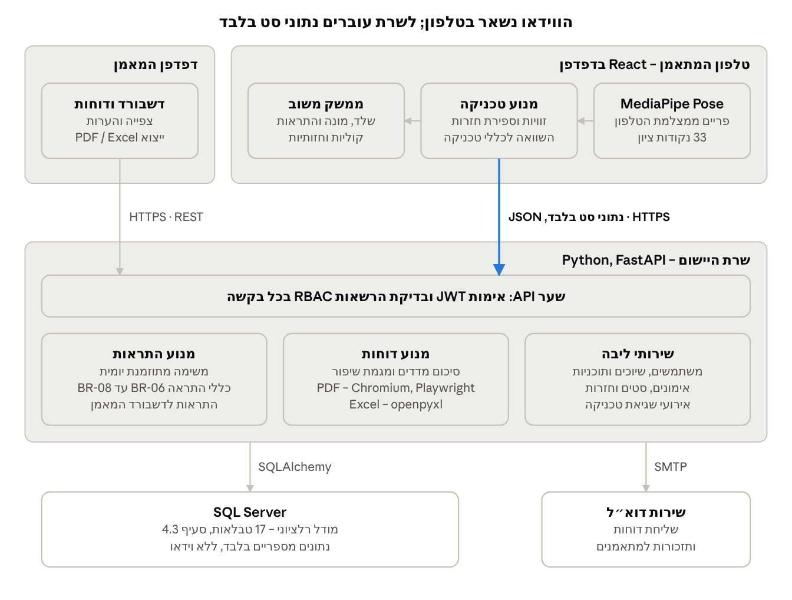
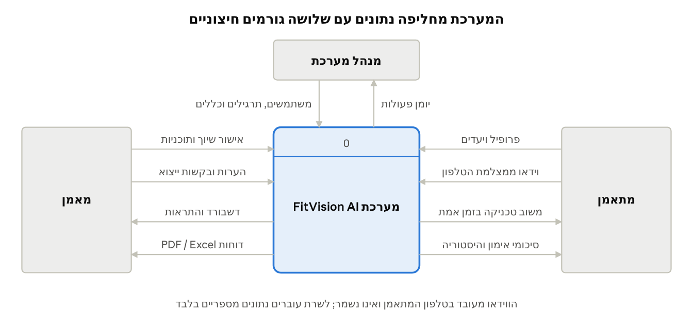
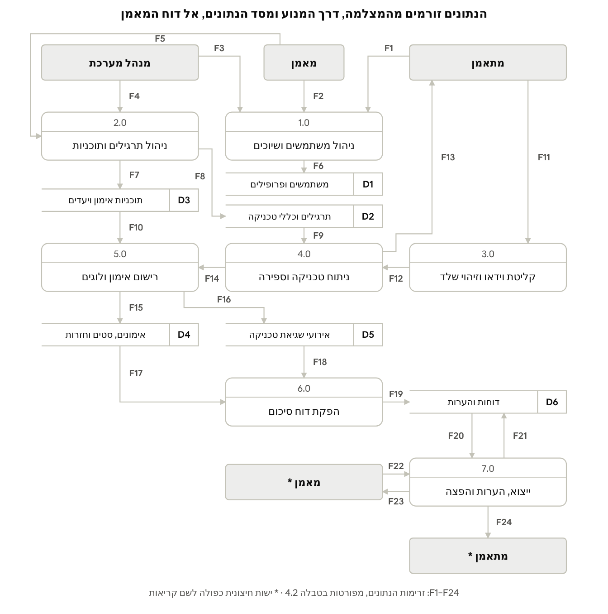
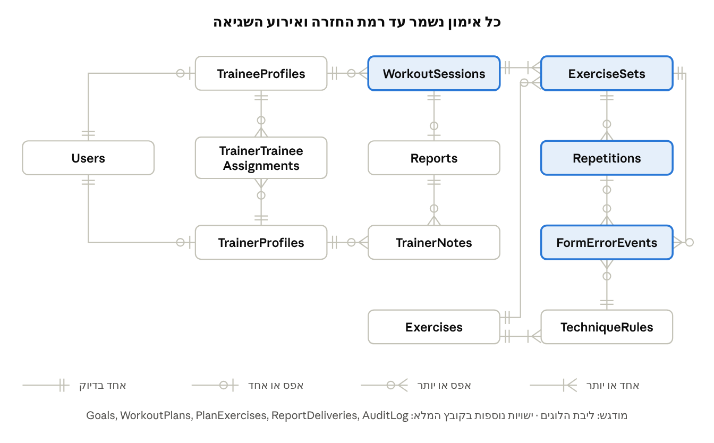
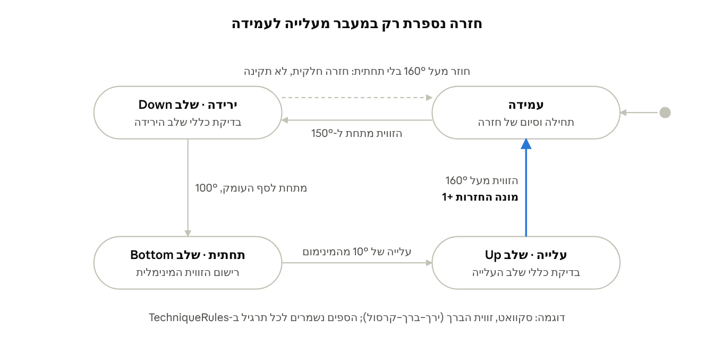

# פרק 4 – ניתוח ותכן המערכת

## 4.1 ארכיטקטורת המערכת

המערכת בנויה משלוש שכבות: לקוח בדפדפן, שרת יישום ומסד נתונים רלציוני. ההחלטה המרכזית היא שניתוח התנועה רץ בטלפון המתאמן, כך שהשרת מקבל נתוני סט מספריים בלבד.



*איור 4.1 – ארכיטקטורת המערכת · שני לקוחות, שרת יישום ומסד נתונים*

שלוש החלטות תכן עיקריות עומדות מאחורי המבנה:

1. **עיבוד בצד הלקוח.** ניתוח התנועה בטלפון מקצר את זמן המשוב (NFR-01), חוסך רוחב פס ומבטיח שהווידאו לא יוצא מהמכשיר (NFR-07). המחיר הוא תלות בחוזק הטלפון, ולכן נקבע רף של 15 פריימים לשנייה (NFR-02). נתוני הסט נשמרים במכשיר עד שהחיבור לשרת מצליח (NFR-12).
2. **שער API יחיד.** כל בקשה, מכל לקוח, עוברת אימות ובדיקת הרשאות באותה נקודה, כך שאין מסלול עקיפה למודל ההרשאות (סעיף 4.5).
3. **דוחות והתראות בשרת.** החישובים נשענים על היסטוריית אימונים (BR-04, BR-06), ולכן מתבצעים מול מסד הנתונים ולא במכשיר.

## 4.2 תרשימי זרימת נתונים (DFD)

הנתונים עוברים שבעה תהליכים, מהפריים במצלמה ועד הדוח אצל המאמן, ונשמרים בשישה מאגרי נתונים. התרשימים משורטטים בסימון Gane & Sarson; הגרסה לעריכה נמצאת בקובץ FitVision\_DFD.drawio.

### רמה 0 – דיאגרמת הקשר



*איור 4.2 – DFD רמה 0 · דיאגרמת הקשר*

דיאגרמת ההקשר מגדירה את גבולות המערכת: שלוש ישויות חיצוניות, ועשר זרימות נתונים בינן לבין המערכת.

### רמה 1 – פירוק לתהליכים



*איור 4.3 – DFD רמה 1 · 7 תהליכים, 6 מאגרים, 24 זרימות*

תהליכים 3.0 ו-4.0 רצים בטלפון המתאמן, ושאר התהליכים רצים בשרת (סעיף 4.1). לכן זרימה F14 היא הזרימה היחידה שעוברת מהמכשיר לשרת במהלך האימון.

**טבלה 4.2 – מילון זרימות נתונים**

| מזהה | מקור | יעד | תוכן הנתונים |
| --- | --- | --- | --- |
| F1 | מתאמן | 1.0 | פרטי הרשמה, פרופיל, מדדים גופניים ובקשת שיוך |
| F2 | מאמן | 1.0 | אישור או דחייה של בקשת שיוך |
| F3 | מנהל מערכת | 1.0 | יצירה, השבתה ושינוי תפקיד של משתמשים |
| F4 | מנהל מערכת | 2.0 | תרגילים וכללי טכניקה: מפרק, נקודות ציון וספי זווית |
| F5 | מאמן | 2.0 | תוכנית אימון: תרגילים, סטים, חזרות, מנוחה ויעדים |
| F6 | 1.0 | D1 | רשומות משתמש, פרופיל ושיוך |
| F7 | 2.0 | D3 | תוכניות אימון ויעדים |
| F8 | 2.0 | D2 | תרגילים וכללי טכניקה |
| F9 | D2 | 4.0 | כללי הטכניקה של התרגיל הנוכחי |
| F10 | D3 | 5.0 | התרגילים המתוכננים לאימון |
| F11 | מתאמן | 3.0 | פריימים ממצלמת הטלפון, מעובדים במכשיר בלבד |
| F12 | 3.0 | 4.0 | 33 נקודות ציון לכל פריים |
| F13 | 4.0 | מתאמן | משוב חזותי וקולי ומונה חזרות |
| F14 | 4.0 | 5.0 | חזרות, זוויות מינימום ומקסימום ואירועי שגיאה |
| F15 | 5.0 | D4 | רשומות אימון, סטים וחזרות |
| F16 | 5.0 | D5 | אירועי שגיאת טכניקה |
| F17 | D4 | 6.0 | נתוני האימון הנוכחי ו-3 האימונים הקודמים באותו תרגיל |
| F18 | D5 | 6.0 | שגיאות לפי סט וכלל טכניקה |
| F19 | 6.0 | D6 | דוח בסטטוס Draft |
| F20 | D6 | 7.0 | דוח שמור והערות קיימות |
| F21 | 7.0 | D6 | הערות מאמן, שינוי סטטוס ורישום ייצוא ושליחה |
| F22 | מאמן | 7.0 | הערה, בקשת ייצוא או בקשת שליחה |
| F23 | 7.0 | מאמן | קובץ PDF או Excel |
| F24 | 7.0 | מתאמן | סיכום אימון רשמי |

בקובץ ה-drawio מופיעות גם קריאות של תהליכים 5.0 ו-6.0 מ-D1 (מזהה המתאמן ויעדיו). הן הושמטו מאיור 4.3 לשם הקריאות.

## 4.3 מודל הנתונים (ERD)

מסד הנתונים כולל 17 טבלאות, וליבתו היא שרשרת התיעוד: אימון ← סט ← חזרה ← אירוע שגיאה. רמת פירוט זו מאפשרת לדוח לקבוע, למשל, שבסט השני הברכיים קרסו פנימה ב-15% מהחזרות. האיור מציג את ליבת המודל; ה-ERD המלא, עם כל השדות וטיפוסי הנתונים, נמצא בקובץ FitVision\_ERD.drawio.



*איור 4.4 – ליבת ה-ERD · 12 מתוך 17 ישויות, סימון Crow's Foot*

**החלטות תכן במודל**

- **הכללה.** TraineeProfiles ו-TrainerProfiles הן תת-טיפוסים זרים של Users לפי השדה role, ומפתחן הראשי הוא גם מפתח זר ל-Users.
- **שיוך כישות נפרדת.** השיוך בין מאמן למתאמן נשמר כטבלה עם סטטוס ותאריכים, ולא כשדה בפרופיל. כך נשמרת ההיסטוריה וניתן לאכוף את BR-09.
- **נרמול עם חריג מכוון.** המודל בצורה נורמלית שלישית (3NF). שדות הסיכום (ציון סט, ציון אימון ושדות הדוח) נשמרים כערכים מחושבים, כדי שהדשבורד לא יחשב מחדש מאלפי חזרות בכל טעינה (NFR-04). הם מחושבים פעם אחת, בסגירת הסט והאימון.
- **כללי טכניקה כנתונים.** כל שורה ב-TechniqueRules מגדירה מפרק, שלוש נקודות ציון וטווח זוויות, כך שתרגיל חדש מתווסף ללא שינוי קוד (NFR-13).

**טבלה 4.3 – מילון ישויות**

| ישות | תיאור | מפתחות | שדות עיקריים |
| --- | --- | --- | --- |
| Users | כל משתמשי המערכת | PK user\_id | email (ייחודי), password\_hash, role, is\_active, consent\_at |
| TraineeProfiles | פרופיל מתאמן | PK, FK user\_id | birth\_date, height\_cm, weight\_kg, fitness\_level, injuries\_notes |
| TrainerProfiles | פרופיל מאמן | PK, FK user\_id | certification, specialization, invite\_code (ייחודי) |
| TrainerTraineeAssignments | שיוך מאמן למתאמן | PK assignment\_id; FK trainer\_id, trainee\_id | status, start\_date, end\_date |
| Goals | יעדי מתאמן | PK goal\_id; FK trainee\_id, set\_by\_id | goal\_type, target\_value, target\_date, status |
| WorkoutPlans | תוכנית אימון | PK plan\_id; FK trainer\_id, trainee\_id | name, start\_date, end\_date |
| PlanExercises | תרגילים בתוכנית (טבלת קישור) | PK plan\_exercise\_id; FK plan\_id, exercise\_id | order\_index, target\_sets, target\_reps, rest\_seconds |
| Exercises | מאגר התרגילים | PK exercise\_id; FK created\_by | name, muscle\_group, camera\_view, is\_active |
| TechniqueRules | כללי טכניקה לתרגיל | PK rule\_id; FK exercise\_id | joint, landmark\_a/b/c, phase, min\_angle, max\_angle, severity, error\_message |
| WorkoutSessions | אימון בודד | PK session\_id; FK trainee\_id, plan\_id (רשות) | started\_at, ended\_at, status, avg\_technique\_score |
| ExerciseSets | סט בתוך אימון | PK set\_id; FK session\_id, exercise\_id | set\_number, total\_reps, valid\_reps, technique\_score, avg\_rom\_deg |
| Repetitions | חזרה בודדת | PK rep\_id; FK set\_id | rep\_number, duration\_ms, min\_angle\_deg, max\_angle\_deg, is\_valid, score |
| FormErrorEvents | אירוע שגיאת טכניקה | PK event\_id; FK set\_id, rep\_id (רשות), rule\_id | occurred\_at, measured\_value, feedback\_text |
| Reports | דוח סיכום לאימון | PK report\_id; FK session\_id (ייחודי) | total\_reps, valid\_reps, avg\_score, improvement\_pct, summary\_json, status |
| TrainerNotes | הערות מאמן לדוח | PK note\_id; FK report\_id, trainer\_id | note\_text, created\_at |
| ReportDeliveries | רישום ייצוא ושליחה | PK delivery\_id; FK report\_id, recipient\_id | channel, file\_format, sent\_at, opened\_at |
| AuditLog | יומן פעולות | PK log\_id; FK user\_id | action, entity\_name, entity\_id, ip\_address, created\_at |

השדות invite\_code ו-consent\_at נוספו בעקבות דרישות US-03 ו-NFR-08.

## 4.4 כללים עסקיים

12 כללים עסקיים קובעים איך נתוני התנועה הופכים לציון, לדוח ולהתראה. הכללים ממומשים בשכבת השירותים בשרת. ערכי הספים (אחוזים, ימים, ניקוד) נשמרים כפרמטרים הניתנים לשינוי, ואינם קבועים בקוד.

**טבלה 4.4 – כללים עסקיים**

| מזהה | תחום | כלל | מקור בדרישות |
| --- | --- | --- | --- |
| BR-01 | תקינות חזרה | חזרה תקינה היא חזרה שהגיעה לסף העומק של התרגיל, וללא שגיאה בחומרה גבוהה (High). חזרה שלא הגיעה לסף העומק נספרת ומסומנת כחלקית | US-05 |
| BR-02 | ציון חזרה | ציון החזרה מתחיל ב-100. מכל שגיאה מופחתות נקודות לפי חומרתה: Low – 5, Med – 15, High – 30. הציון המינימלי הוא 0 | US-05, US-06 |
| BR-03 | ציון סט ואימון | ציון סט הוא ממוצע ציוני החזרות בו. ציון אימון הוא ממוצע ציוני הסטים, משוקלל לפי מספר החזרות בכל סט | US-07, US-12 |
| BR-04 | מגמת שיפור | ציון התרגיל באימון הנוכחי מושווה לממוצע 3 האימונים הקודמים באותו תרגיל. אם יש פחות מ-3 אימונים קודמים, מוצג "אין מספיק נתונים" | US-12, US-17 |
| BR-05 | נקודת כשל | כלל טכניקה שהופר ב-15% לפחות מהחזרות בסט מוצג בדוח כנקודת כשל, יחד עם אחוז החזרות שבהן הופר | US-12 |
| BR-06 | התראה – שגיאה חוזרת | כלל שזוהה כנקודת כשל ב-3 אימונים רצופים מייצר התראה בדשבורד המאמן | US-16 |
| BR-07 | התראה – ירידה בציון | ממוצע ציון שבועי שירד ביותר מ-5% לעומת השבוע הקודם מייצר התראה | US-16 |
| BR-08 | התראה – חוסר פעילות | מתאמן עם תוכנית פעילה שלא התאמן יותר מ-5 ימים מייצר התראה, ומאפשר למאמן לשלוח תזכורת | US-16 |
| BR-09 | שיוך | למתאמן יש לכל היותר שיוך פעיל אחד. המאמן רואה רק אימונים שבוצעו מתאריך תחילת השיוך, וגישתו נסגרת מיד בסיום השיוך | US-03, US-09 |
| BR-10 | מחזור חיי דוח | דוח נוצר בסטטוס Draft, עובר ל-Reviewed כשהמאמן מוסיף הערה, ול-Sent כשהוא נשלח למתאמן. דוח בסטטוס Sent אינו ניתן לעריכה, אלא רק להוספת הערה חדשה | US-13, US-15 |
| BR-11 | משוב בזמן אמת | בכל חזרה מוצגת לכל היותר התראה אחת. אם הופרו כמה כללים, מוצגת ההתראה בעלת החומרה הגבוהה ביותר | US-06 |
| BR-12 | אימון שהופסק | אימון שהופסק לפני סיומו נשמר בסטטוס Aborted. דוח חלקי מופק רק אם הושלם בו סט אחד לפחות | UC-1, תרחיש 8א |

## 4.5 מודל הרשאות (RBAC)

ההרשאות נקבעות בשני שלבים: תפקיד המשתמש קובע אילו פעולות מותרות לו, ושיוך פעיל קובע על אילו נתונים מאמן רשאי לפעול. לפי עיקרון ההרשאה המינימלית, מנהל המערכת מנהל משתמשים ותרגילים, אך אינו רואה נתוני ביצוע של מתאמנים.

**טבלה 4.5 – מטריצת הרשאות**

| פעולה או משאב | מתאמן | מאמן | מנהל מערכת |
| --- | --- | --- | --- |
| צפייה ועדכון פרופיל | שלו בלבד | שלו; צפייה בפרופילי משויכים | כל המשתמשים |
| שליחת בקשת שיוך | כן | — | — |
| אישור, דחייה וסיום שיוך | סיום בלבד | כן, לבקשות אליו | סיום בלבד |
| יצירה ועריכה של תוכנית אימון | צפייה בשלו | משויכים בלבד | — |
| ביצוע אימון | כן | — | — |
| צפייה באימונים, בדוחות ובמגמות | שלו בלבד | משויכים, מתאריך השיוך | — |
| הוספת הערות, ייצוא ושליחת דוח | — | משויכים בלבד | — |
| דשבורד והתראות | — | משויכים בלבד | — |
| מאגר תרגילים וכללי טכניקה | צפייה | צפייה | ניהול מלא |
| ניהול משתמשים ותפקידים | — | — | כן |
| יומן פעולות | — | — | צפייה בלבד |

**אכיפה.** ההרשאות נאכפות בשרת, בכל בקשה (NFR-06), ולא רק בהסתרת כפתורים בממשק:

1. אסימון ה-JWT מזהה את המשתמש ואת תפקידו.
2. השרת בודק שהתפקיד מורשה לפעולה לפי המטריצה.
3. בפעולה של מאמן על נתוני מתאמן, השרת מוודא שקיימת רשומה ב-TrainerTraineeAssignments בסטטוס Active, ושהנתונים מתאריך תחילת השיוך (BR-09).
4. כל ניסיון גישה שנדחה נרשם ב-AuditLog.

## 4.6 אלגוריתם ניתוח הטכניקה

בכל פריים מנוע הטכניקה מבצע שלושה שלבים: מחשב זוויות מפרקים מנקודות הציון, מעדכן מכונת מצבים שסופרת חזרות, ובודק את הזוויות מול כללי הטכניקה של השלב הנוכחי. כל השלבים רצים בטלפון (תהליך 4.0 ב-DFD).

**שלב 1 – חישוב זווית מפרק.** הזווית במפרק B (למשל הברך) מחושבת משלוש נקודות ציון: A (ירך), B (ברך) ו-C (קרסול).

```latex
\theta_B = \arccos\left(\frac{\vec{BA}\cdot\vec{BC}}{\lVert\vec{BA}\rVert\,\lVert\vec{BC}\rVert}\right)
```

כדי לצמצם רעש בין פריימים, הזווית מוחלקת בממוצע נע של 5 פריימים. נקודת ציון שציון הנראות (visibility) שלה נמוך מ-0.5 אינה משמשת לחישוב, והפריים מדולג.

**שלב 2 – ספירת חזרות במכונת מצבים.**



*איור 4.5 – מכונת המצבים לספירת חזרות · 4 מצבים*

הספים מפרידים בין כניסה לירידה (150°) לבין חזרה לעמידה (160°), כך שרעידה קלה סביב סף אחד אינה מוסיפה חזרה (hysteresis). חזרה שלא הגיעה לסף העומק נספרת כחלקית ומסומנת כלא תקינה (BR-01).

**שלב 3 – בדיקת כללי טכניקה.** בכל פריים המנוע בודק את כללי TechniqueRules של התרגיל עבור השלב הנוכחי (Down, Bottom או Up), ומשווה את הזווית לטווח התקין. חריגה שנמשכת 3 פריימים רצופים נרשמת כאירוע שגיאה ומפעילה משוב לפי BR-11. בסיום כל חזרה מחושבים תקינותה וציונה לפי BR-01 ו-BR-02.

**טבלה 4.6 – דוגמאות לכללי טכניקה ב-MVP**

| תרגיל | מפרק (נקודות ציון) | מבט מצלמה | שלב | טווח תקין | הודעת תיקון |
| --- | --- | --- | --- | --- | --- |
| סקוואט | ברך (ירך–ברך–קרסול) | חזית | Bottom | 100° לכל היותר | רד עמוק יותר |
| סקוואט | ברך (ירך–ברך–קרסול) | חזית | Down, Bottom | 165° לפחות | דחוף את הברכיים החוצה |
| לאנג'ים | ברך קדמית (ירך–ברך–קרסול) | צד | Bottom | 80°–100° | שמור על זווית ישרה בברך הקדמית |
| כפיפת מרפקים | כתף (מרפק–כתף–ירך) | צד | כל השלבים | 20° לכל היותר | הצמד את המרפק לגוף |
| כפיפת מרפקים | מרפק (כתף–מרפק–שורש כף יד) | צד | Bottom | 50° לכל היותר | השלם את התנועה עד למעלה |
| לחיצת כתפיים | מרפק (כתף–מרפק–שורש כף יד) | חזית | Up | 160° לפחות | יישר את הידיים עד הסוף |
| לחיצת כתפיים | כתף (מרפק–כתף–ירך) | חזית | Bottom | 100° לכל היותר | הורד את המשקולות עד גובה הכתפיים |

לכל תרגיל כיוון מצלמה אחד (Exercises.camera\_view), ולכן כל כללי התרגיל נבדקים מאותו מבט. בסקוואט המבט חזיתי, כדי לזהות קריסת ברכיים; את העומק מחשבים מהקואורדינטות התלת-ממדיות (world landmarks) ש-MediaPipe מחזיר לכל נקודת ציון.

הספים בטבלה הם ערכי פתיחה, ויכוילו מול מאמן מוסמך ומול סרטונים מתויגים בשלב הבדיקות (פרק 9). מאחר שהם נשמרים כנתונים, הכיול אינו דורש שינוי קוד.
