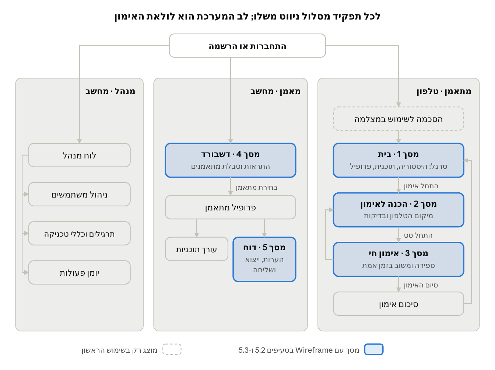
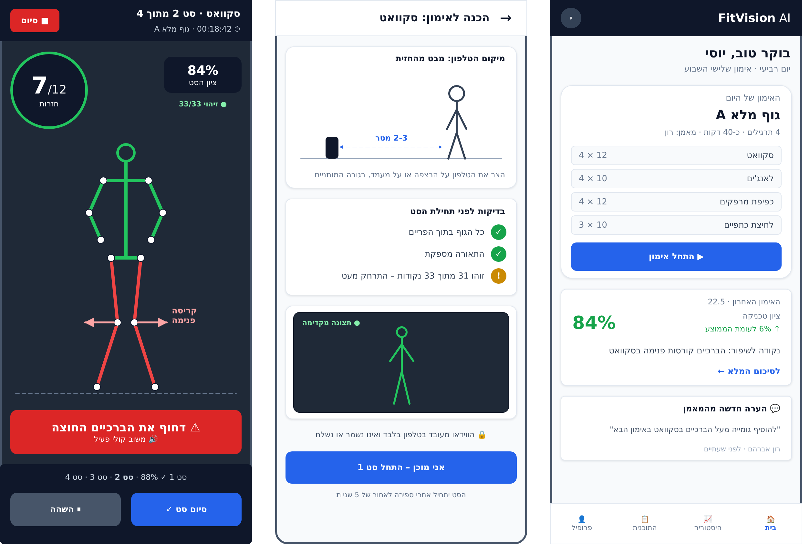
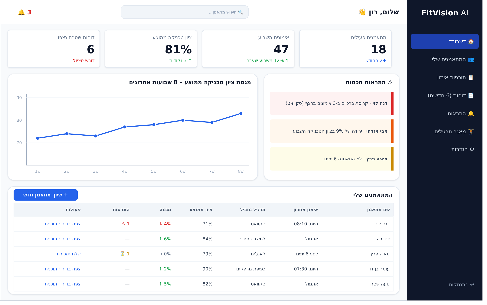
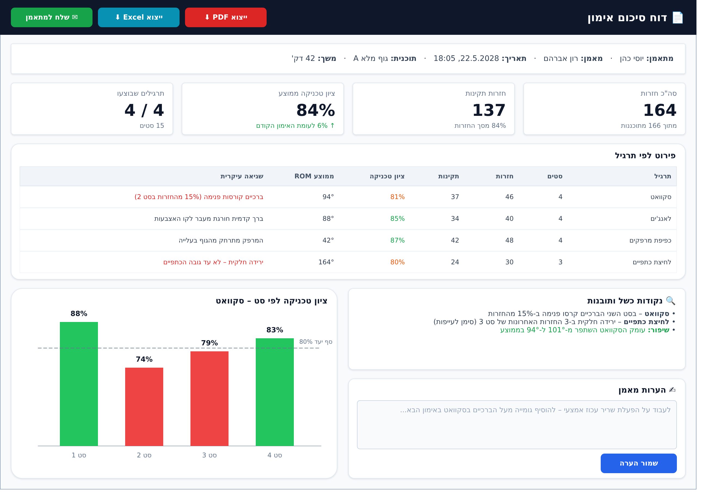

# פרק 5 – אפיון ממשק המשתמש

## 5.1 מפת מסכים וניווט

למערכת שלושה מסלולי ניווט, אחד לכל תפקיד, שמתפצלים ממסך התחברות משותף לפי התפקיד של המשתמש (RBAC, סעיף 4.5). המתאמן עובד בטלפון, כי הטלפון הוא גם המצלמה; המאמן ומנהל המערכת עובדים במחשב, כי עבודתם מבוססת טבלאות ודוחות.

*איור 5.1 – מפת מסכים וניווט · 3 תפקידים, 5 מסכים מאופיינים*

לב המערכת הוא לולאת האימון של המתאמן: בין סט לסט המתאמן חוזר ממסך 3 למסך 2, כדי למקם מחדש את הטלפון לתרגיל הבא, ובסיום האימון מוצג סיכום והוא חוזר למסך הבית. המאמן יכול להגיע לדוח גם ישירות מהתראה בדשבורד, בלי לעבור בפרופיל המתאמן.

## 5.2 מסכי המתאמן (טלפון)

שלושת מסכי המתאמן מלווים את האימון מהפתיחה ועד הסט האחרון, ומתוכננים לטלפון במצב אנכי (390 × 844 פיקסלים). מסך האימון החי נקרא ממרחק של 2 עד 3 מטרים, ולכן המידע בו מצומצם למונה, לציון ולהודעת משוב אחת בכל רגע.

**איור 5.2 – מסכי המתאמן מימין לשמאל: בית, הכנה לאימון, אימון חי**

| מסך | מטרה | רכיבים מרכזיים | User Stories |
| --- | --- | --- | --- |
| 1 · בית | נקודת הכניסה לאימון היומי | האימון מהתוכנית עם כפתור התחלה; ציון האימון האחרון ומגמתו (BR-04); נקודה לשיפור; הערת מאמן חדשה; סרגל ניווט תחתון | US-04, US-07, US-08 |
| 2 · הכנה לאימון | לוודא שהמצלמה רואה את כל הגוף לפני כל תרגיל | הנחיית מיקום לפי Exercises.camera\_view; רשימת בדיקות חיה (גוף בפריים, תאורה, מספר נקודות ציון); תצוגה מקדימה; הודעת פרטיות | US-04 |
| 3 · אימון חי | ספירה ומשוב בזמן הביצוע | שלד מעל הווידאו (מפרקים חריגים באדום); מונה חזרות גדול; ציון הסט; פס משוב אדום עם קול; התקדמות הסטים | US-05, US-06 |

בשימוש הראשון מוצג לפני מסך 2 מסך הסכמה לשימוש במצלמה (NFR-08), ומסך 2 משנה את ההנחיה לפי כיוון המצלמה של התרגיל: סקוואט ולחיצת כתפיים מהחזית; לאנג'ים וכפיפת מרפקים מהצד.

## 5.3 מסכי המאמן (מחשב)

שני מסכי המאמן עונים על שתי שאלות: "למי לפנות קודם?" (הדשבורד) ו-"מה קרה באימון?" (הדוח). הם מתוכננים למסך מחשב ברוחב 1280 פיקסלים, שבו טבלאות וגרפים נקראים בנוחות.

**איור 5.3 – מסך 4: דשבורד המאמן**

הדשבורד בנוי מהכללי לפרטי:

1. **מדדים מרכזיים** – מתאמנים פעילים, אימונים השבוע, ציון ממוצע ודוחות שטרם נצפו.
2. **התראות** – מופקות לפי BR-06 עד BR-08, וממוינות לפי חומרה: שגיאה חוזרת, ירידה בציון, חוסר פעילות.
3. **מגמה** – ציון הטכניקה הממוצע של כל המתאמנים ב-8 שבועות.
4. **טבלת מתאמנים** – שורה לכל מתאמן משויך, עם מיון וקישור לדוח ולתוכנית (US-10, US-16, US-17).

**איור 5.4 – מסך 5: דוח סיכום אימון**

הדוח מציג את מה שנדרש ב-US-12: סך החזרות מול המתוכנן, ציון טכניקה ומגמה, פירוט לפי תרגיל ונקודות כשל לפי BR-05. הגרף מציג את ציון הטכניקה בכל סט מול סף יעד של 80%, כך שהמאמן רואה במבט אחד באיזה סט הטכניקה נשברה. שלושת הכפתורים בראש המסך מממשים את מקרי ה-«extend» של UC-2: ייצוא PDF, ייצוא Excel ושליחה למתאמן (US-13 עד US-15).

## 5.4 עקרונות עיצוב

שבעה עקרונות מנחים את כל המסכים, וכל עקרון קשור לדרישה מפרק 3. העקרון המכריע במסכי המתאמן הוא קריאות מרחוק, כי בזמן התרגיל המתאמן לא נוגע בטלפון.

**טבלה 5.1 – עקרונות עיצוב**

| עקרון | יישום במסכים | דרישה |
| --- | --- | --- |
| קריאות מרחוק | במסך 3: מונה חזרות בגודל 36 פיקסלים לפחות, פס משוב בגובה 68 פיקסלים ומשוב קולי; הודעה אחת בלבד בכל רגע | US-06, BR-11 |
| מכשיר לפי הקשר | מתאמן – טלפון במצב אנכי; מאמן ומנהל – מחשב. מסכי המאמן מתכווצים גם לטאבלט | NFR-11 |
| עברית מימין לשמאל | כל המסכים בכיווניות RTL, עם טיפול נכון במספרים ובמונחים באנגלית; גם קבצי ה-PDF וה-Excel מופקים בעברית | NFR-10 |
| משמעות קבועה לצבעים | ירוק – תקין; אדום – חריגה מכלל טכניקה; כתום – אזהרה או ציון מתחת לסף; כחול – פעולה ראשית | NFR-09 |
| נגישות | משמעות לא מועברת בצבע בלבד (גם סמל וטקסט); ניגודיות טקסט לפי WCAG 2.1 ברמת AA; כפתורי מגע בגובה 44 פיקסלים לפחות; משוב קולי שניתן להשתיק | NFR-09 |
| פרטיות גלויה | מסך הסכמה לפני שימוש ראשון במצלמה, והודעה קבועה במסך 2 שהווידאו אינו נשמר | NFR-07, NFR-08 |
| מצבי קצה מוגדרים | הודעה ברורה לכל מצב חריג (טבלה 5.2), במקום מסך ריק או שגיאה טכנית | NFR-12, BR-04 |

**טבלה 5.2 – מצבי קצה ותגובת הממשק**

| מצב | מסך | תגובת הממשק |
| --- | --- | --- |
| השלד לא מזוהה במלואו | 2, 3 | הנחיה להתרחק או לשפר תאורה; אחרי 2 שניות באימון חי – הסט מושהה |
| אין חיבור לרשת | 3 | "נשמר במכשיר, יסונכרן כשהחיבור יחזור"; האימון ממשיך כרגיל |
| מתאמן ללא מאמן משויך | 1 | כרטיס "התחבר למאמן" עם שדה לקוד הזמנה, במקום כרטיס ההערה |
| מתאמן ללא תוכנית פעילה | 1 | בחירת תרגיל בודד מהמאגר לאימון חופשי |
| פחות מ-3 אימונים קודמים | 1, 5 | "אין מספיק נתונים למגמה" במקום אחוז שיפור (BR-04) |
| מאמן ללא מתאמנים | 4 | מסך פתיחה עם קוד ההזמנה של המאמן והסבר איך לשתף אותו |
