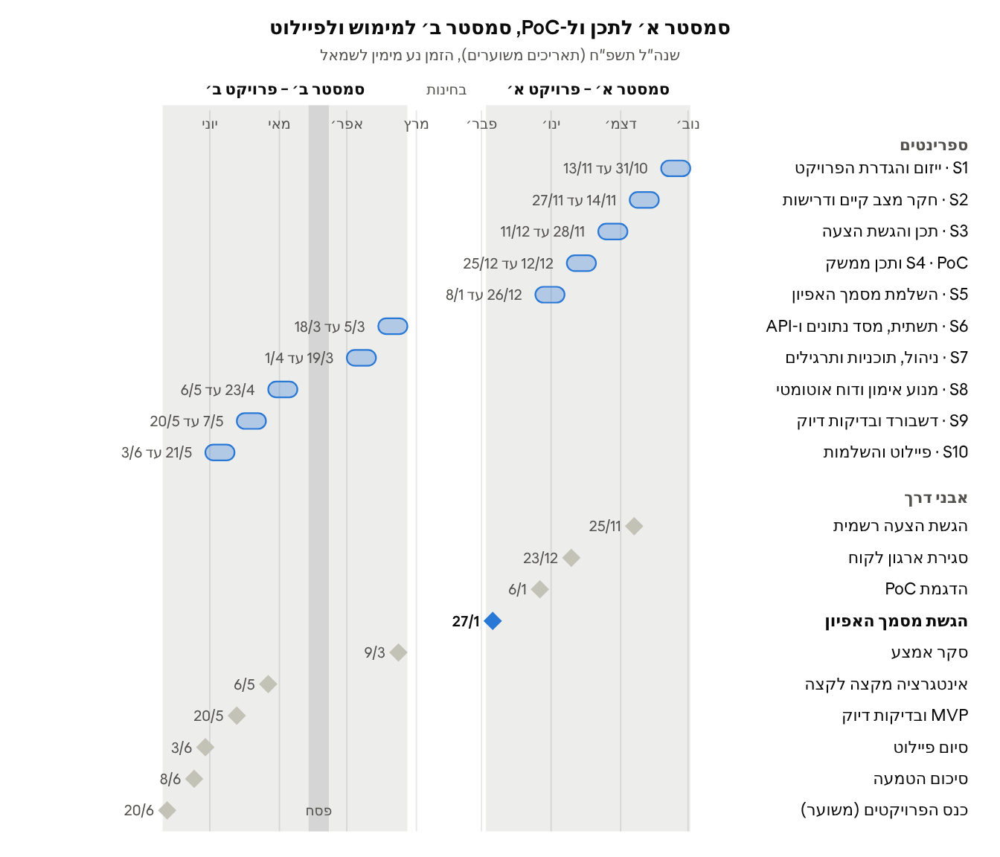

# פרק 7 – תוכנית עבודה וניהול הפרויקט

## 7.1 מתודולוגיית ניהול הפרויקט

הפרויקט מנוהל ב-Scrum, ב-10 ספרינטים של שבועיים באורך שני הסמסטרים: 5 בסמסטר א' ו-5 בסמסטר ב'. הבחירה תואמת את נוהל הפרויקטים של החוג. הנוהל מחייב עבודה איטרטיבית, פירוק הדרישות ל-User Stories והצגת התקדמות ללקוח בסוף כל איטרציה.

**התאמה לפרויקט אקדמי.** צוות של 4 סטודנטים עובד כ-10 שעות בשבוע לכל חבר, כפי שמעריך הנוהל. זה נותן כ-80 שעות עבודה בספרינט. מכיוון שהצוות לא עובד יחד כל יום, הפגישה היומית מוחלפת בעדכון כתוב ובשתי פגישות קצרות בשבוע.

**תפקידי Scrum**

- **Product Owner** – נציג ארגון הלקוח (מאמן הסטודיו). מנהל האיכות וה-PMO של הצוות משמש כנציגו בצוות ומנהל את סדר העדיפויות ב-Backlog.
- **Scrum Master** – מנהל האיכות וה-PMO (סעיף 7.4): מנחה את הטקסים ומסיר חסמים.
- **צוות הפיתוח** – כל ארבעת חברי הצוות.
- **המנחה האקדמי** – בעל עניין שמשתתף ב-Sprint Review, לפחות פעמיים בסמסטר, כפי שקובע הנוהל.

**טבלה 7.1 – טקסי Scrum בפרויקט**

| טקס | מועד ומשך | משתתפים | תוצר |
| --- | --- | --- | --- |
| Sprint Planning | יום ראשון של הספרינט, 90 דקות | צוות | Sprint Backlog עם הערכת Story Points ומטרת ספרינט במשפט אחד |
| Standup מותאם | פעמיים בשבוע, 15 דקות מקוונות; בשאר הימים עדכון כתוב בערוץ הצוות | צוות | עדכון התקדמות ורשימת חסמים |
| Backlog Refinement | אמצע הספרינט, 45 דקות | צוות | User Stories מפורקים, מוערכים ומוכנים לספרינט הבא |
| Sprint Review | סוף הספרינט, 45 דקות | צוות, נציג הלקוח, המנחה (לפחות פעמיים בסמסטר) | הדגמה עובדת, משוב ועדכון סדר העדיפויות |
| Retrospective | סוף הספרינט, 30 דקות | צוות | שני שיפורים לכל היותר לספרינט הבא, עם אחראי |

**לוח Kanban.** המשימות מנוהלות ב-GitHub Projects (סעיף 6.2) בשש עמודות: Backlog, Sprint Backlog, בביצוע, סקירת קוד, בדיקה ו-Done. כל חבר צוות מחזיק שתי משימות לכל היותר בעמודת "בביצוע" (מגבלת WIP), כדי שמשימות ייסגרו לפני שנפתחות חדשות.

**הגדרת Done.** משימה עוברת ל-Done רק כאשר:

- קריטריוני הקבלה של ה-User Story (טבלה 3.2) מתקיימים ונבדקו.
- הבדיקות האוטומטיות עוברות ב-CI.
- הקוד נסקר ב-Pull Request ומוזג לענף develop.
- תיעוד ה-API ומסמך האפיון עודכנו במידת הצורך.

## 7.2 פירוק משימות ו-Product Backlog

ה-Backlog כולל 20 User Stories מפרק 3, מקובצים ל-7 אפיקים (Epics), ועוד 5 משימות תשתית. הערכת ההיקף הכוללת היא 113 Story Points: 87 ל-User Stories ו-26 למשימות התשתית. Story Points נמדדים בסדרת פיבונצ'י (1, 2, 3, 5, 8) ומבטאים מורכבות יחסית, לא שעות. העדיפות נלקחת מטבלה 3.2.

**טבלה 7.2 – Product Backlog**

| Epic | US | תיאור | משימות הנדסיות | SP | עדיפות | ספרינט |
| --- | --- | --- | --- | --- | --- | --- |
| E1 משתמשים והרשאות | US-01 | הרשמה והתחברות | API אימות עם JWT; גיבוב סיסמאות ב-Argon2; מסכי התחברות והרשמה | 5 | Must | S6 |
| E1 | US-02 | פרופיל מתאמן | API פרופיל עם אימות טווחים; מסך עריכה | 3 | Must | S6 |
| E1 | US-18 | ניהול משתמשים ותפקידים | תלות הרשאות ב-FastAPI; מסך מנהל; רישום ב-AuditLog | 3 | Must | S6 |
| E1 | US-03 | בקשת שיוך בקוד הזמנה | הפקת invite\_code; יצירת שיוך Pending; התראה למאמן | 3 | Must | S7 |
| E1 | US-09 | אישור או דחיית שיוך | מעברי סטטוס; אכיפת BR-09 בכל שאילתה | 3 | Must | S7 |
| E2 תרגילים ותוכניות | US-19 | ניהול תרגילים וכללי טכניקה | CRUD לתרגילים ול-TechniqueRules; הזנת כללי טבלה 4.6 | 5 | Must | S7 |
| E2 | US-11 | בניית תוכנית אימון | API תוכניות ו-PlanExercises; עורך תוכניות למאמן | 5 | Must | S7 |
| E3 מנוע הראייה והאימון החי | US-04 | הפעלת מצלמה והכנה לאימון | getUserMedia; מסך הסכמה; מסך 2 עם בדיקות פריים ותאורה | 5 | Must | S7 |
| E3 | US-05 | ספירת חזרות | MediaPipe ב-Web Worker; מכונת מצבים ל-4 התרגילים (מרחיב את ה-PoC) | 8 | Must | S8 |
| E3 | US-06 | משוב בזמן אמת | בדיקת כללים לפי שלב; שכבת Canvas; משוב קולי; מדידת השהיה מול NFR-01 | 8 | Must | S8 |
| E4 תיעוד אימון והיסטוריה | US-07 | סיכום אימון למתאמן | מסך סיכום; חישוב BR-02 ו-BR-03 | 3 | Should | S9 |
| E4 | US-08 | היסטוריית אימונים | API עם סינון ודפדוף; גרף ציון לאורך זמן | 3 | Should | S10 |
| E5 דוחות למאמן | US-12 | דוח סיכום אוטומטי | מנוע דוחות; BR-04 ו-BR-05; מסך 5 | 8 | Must | S8 |
| E5 | US-13 | הערות מאמן | טבלת TrainerNotes; מעבר ל-Reviewed | 2 | Should | S9 |
| E5 | US-14 | ייצוא PDF ו-Excel | תבנית Jinja2; Chromium ו-Playwright; openpyxl; מדידה מול NFR-03 | 5 | Must | S9 |
| E5 | US-15 | שליחת דוח למתאמן | שליחה ב-SMTP ובמערכת; רישום ב-ReportDeliveries | 3 | Should | S10 |
| E6 דשבורד והתראות | US-10 | דשבורד מאמן | שאילתות מצרפיות; טבלה עם מיון; מסך 4 | 5 | Must | S9 |
| E6 | US-16 | התראות | משימה מתוזמנת ב-APScheduler; BR-06 עד BR-08 | 5 | Should | S10 |
| E6 | US-17 | מגמות התקדמות | שאילתות Window Functions; גרף ל-4, 8 או 12 שבועות | 3 | Should | S10 |
| E7 בקרה | US-20 | יומן פעולות | מסך צפייה וסינון ב-AuditLog | 2 | Could | S10 |

**טבלה 7.3 – משימות תשתית**

| מזהה | משימה | SP | ספרינט |
| --- | --- | --- | --- |
| T-01 | הקמת סביבה: מאגר, CI ו-SQL Server ב-Docker | 3 | S6 |
| T-02 | סכמת 17 הטבלאות והגירות Alembic | 5 | S6 |
| T-03 | PoC: MediaPipe בדפדפן וספירת חזרות בסקוואט | 8 | S4–S5 |
| T-04 | מערך בדיקות דיוק: 40 סרטונים מתויגים על ידי מאמן מוסמך | 5 | S9 |
| T-05 | פיילוט והטמעה בארגון הלקוח | 5 | S10 |

**בדיקת היתכנות היקף.** התכנון מניח קצב של 20 עד 25 Story Points בספרינט מימוש, והוא יכויל לפי הקצב בפועל אחרי ספרינט 6. כל פריטי ה-Must מתוכננים עד ספרינט 9. אם הקצב בפועל נמוך מהמתוכנן, פריטי ה-Should וה-Could בספרינט 10 יידחו ראשונים, בהתאם לשיטת MoSCoW.

## 7.3 לוח זמנים ואבני דרך

סמסטר א' מוקדש לאפיון, לתכן ולהוכחת היתכנות (PoC), ונסגר בהגשת מסמך האפיון ב-27/1/2028. סמסטר ב' מוקדש למימוש, לבדיקות ולפיילוט, ונסגר בכנס הפרויקטים. הפרויקט מתוכנן לשנה"ל תשפ"ח. לוח השנה האקדמית של אוניברסיטת חיפה לתשפ"ח טרם פורסם, ולכן התאריכים משוערים לפי מועדי החגים ולפי מבנה לוח תשפ"ז: סמסטר א' בין 31/10/2027 ל-30/1/2028, וסמסטר ב' בין 5/3/2028 ל-22/6/2028. התאריכים יעודכנו עם פרסום הלוח הרשמי (לוח תשפ"ז של [אוניברסיטת חיפה](https://www.haifa.ac.il/wp-content/uploads/2025/12/2026-7.pdf)).

*איור 7.1 – לוח זמנים · 10 ספרינטים ו-10 אבני דרך, שנה"ל תשפ"ח*

בין ספרינט 7 לספרינט 8 מתוכננים שבוע חיץ, חופשת פסח (9/4 עד 18/4/2028) וימי השלמה. בין ספרינט 5 לסוף סמסטר א' נשארות שלושה שבועות לתיקונים במסמך. תקופת הבחינות אינה מתוכננת כספרינט.

**הנחות לגבי אבני הדרך**

- **סקר אמצע** נקבע לשבוע הראשון של סמסטר ב', כפי שקובע נוהל הפרויקטים.
- **סיכום ההטמעה** נקבע כשבועיים לפני סוף סמסטר ב', כפי שקובע הנוהל.
- **הגשת ההצעה** ו**כנס הפרויקטים** הם יעדי תכנון. התאריכים הסופיים יעודכנו לפי הודעת רכז הפרויקטים.

**טבלה 7.5 – מטרות ותוצרים לפי ספרינט**

| ספרינט | מטרה | תוצרים עיקריים | פריטי Backlog |
| --- | --- | --- | --- |
| S1 | גיבוש צוות, הגדרת רעיון ואיתור מנחה | תקציר הפרויקט ומבנה המסמך | — |
| S2 | חקר מצב קיים וראיונות עם מאמנים | פרקים 1 עד 3 בטיוטה | — |
| S3 | תכן מערכת והגשת הצעה רשמית | Use Case, DFD, ERD; הצעת הפרויקט | — |
| S4 | הוכחת היתכנות ותכן ממשק | MediaPipe רץ בדפדפן הטלפון; Wireframes | T-03 |
| S5 | השלמת מסמך האפיון | ספירת חזרות בסקוואט (PoC); פרקים 4 עד 9 | T-03 |
| S6 | תשתית וניהול משתמשים | מסד נתונים עם 17 טבלאות, CI, הרשמה והרשאות | T-01, T-02, US-01, US-02, US-18 |
| S7 | שיוכים, תוכניות ותרגילים | שיוך מאמן למתאמן, עורך תוכניות, מאגר כללים, מסך הכנה | US-03, US-04, US-09, US-11, US-19 |
| S8 | מנוע האימון והדוח | אימון חי ל-4 התרגילים, תיעוד לוגים, דוח אוטומטי | US-05, US-06, US-12 |
| S9 | כלי המאמן ובדיקות דיוק | דשבורד, ייצוא PDF ו-Excel, בדיקות מול 40 סרטונים מתויגים | US-07, US-10, US-13, US-14, T-04 |
| S10 | פיילוט והשלמות | פיילוט בארגון הלקוח, התראות, מגמות, שליחת דוחות | T-05, US-08, US-15, US-16, US-17, US-20 |

## 7.4 חלוקת תפקידים ואחריות

לכל אחד מארבעת חברי הצוות תחום אחריות מובהק, שמשלב משימות פיתוח עם משימות ניתוח וניהול. לכל תחום מוגדר גם גיבוי, כדי שעומס של בחינות או היעדרות של חבר אחד לא יעצור ספרינט. החלוקה מאזנת את העומס: שלושת המפתחים מובילים 33 עד 34 Story Points כל אחד, וחבר 4 מוביל 12 (סה"כ 113).

**טבלה 7.4 – תפקידים בצוות**

| # | תפקיד | תחומי אחריות | תוצרים עיקריים | אפיקים ומשימות מובלים | גיבוי |
| --- | --- | --- | --- | --- | --- |
| 1 | מפתח Full-Stack מוביל ומנהל ארכיטקטורה ומסדי נתונים | ארכיטקטורת המערכת; SQL Server והגירות; ממשקי FastAPI; מודל ההרשאות; מנוע הדוחות | פרק 4 (ERD, DFD, הרשאות); שרת ו-API; מנוע הדוחות | E1, US-12, T-01, T-02 (סה"כ 33 SP) | 2 |
| 2 | מפתח Frontend ואחראי שמישות ו-UI/UX | ממשק React לטלפון ולמחשב; מימין לשמאל ונגישות; מצלמה ו-Canvas; PWA ואחסון מקומי; תבניות הדוח וייצוא PDF ו-Excel | פרק 5 (Wireframes, עקרונות עיצוב); מסכים 1 עד 5 | E4, E6, US-04, US-13, US-14, US-15 (סה"כ 34 SP) | 3 |
| 3 | מהנדס אלגוריתמים ואינטגרציית AI | הטמעת MediaPipe ב-Web Worker; חישוב זוויות ומכונת המצבים; הגדרת כללי טכניקה וכיולם; ביצועים בטלפון | סעיף 4.6; ה-PoC; מנוע הטכניקה; ספים מכוילים | E2, US-05, US-06, T-03 (סה"כ 34 SP) | 4 |
| 4 | מנהל איכות, בדיקות ו-PMO (Scrum Master) | ניהול ה-Backlog והטקסים; קשר עם ארגון הלקוח והמנחה; תוכנית הבדיקות; בדיקות דיוק מול סרטונים מתויגים; ניהול סיכונים | פרקים 7 עד 9; דוחות ספרינט; אוסף Postman; תיק תחזוקה; סיכום הטמעה | E7, T-04, T-05, בדיקות קבלה לכל האפיקים (סה"כ 12 SP ועוד ניהול ובדיקות) | 1 |

העומס של חבר 4 נמוך ב-Story Points במכוון: הוא מקדיש כשליש מהזמן לניהול, לתיאום עם הלקוח ולבדיקות הקבלה של כל האפיקים.

**אחריות משותפת לכל הצוות**

- סקירת קוד: כל Pull Request נסקר על ידי חבר צוות מתחום אחר, וכך נשמר ידע משותף בכל השכבות.
- כתיבת מסמך האפיון: כל חבר כותב את הפרקים שבתחומו, וחבר 4 אחראי לאחידות ולעריכה הסופית.
- כנס הפרויקטים: כל הצוות משתתף בהדגמה, בפוסטר ובמצגת.
